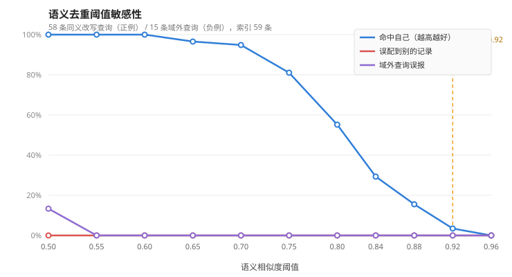

# AI 能力评测报告

> 生成时间：2026-10-04 15:33
> 由 `fact-agent/eval/evaluate.py` 自动生成；原始数据见 `fact-agent/eval/results/`

## 重要局限（先读这一段）

- 评测集 `fact-agent/eval/dataset.jsonl` 是**作者自行标注的 60 条内部小样本**，
  **不是**公开基准数据集；标签代表作者判断，可用于回归对比与调参，不足以支撑对外的性能宣称。
- 样本量小（60 条），指标存在较大随机波动，不能当作稳定性能指标。
- 去重评测只用本地 embedding 模型（bge-small-zh），不需要联网，可完全复现；
  判定评测需要真实 LLM 与搜索服务，会消耗 API 配额，且结论受搜索源质量影响。
- 评测方法：去重评测用**同义改写**作为留出查询（期望命中自己的原文），
  另用一组**域外问题**作为负例（期望不命中）。不能拿“已入库的原文”当查询——那样必然命中自己。

## 一、语义去重评测（离线）

- 数据集：**60** 条，其中进入索引 **59** 条
- 正例查询：**58** 条同义改写；负例查询：**15** 条域外问题 + **12** 条困难负例（关键词相近但问题不同）
- embedding 模型：`bge_model`
- 当前配置阈值：**0.92**，最短文本长度：8

⚠️ 有 **1** 条样本因长度不足 `min_text_length=8` **未进入索引**，因此这些消息只能走精确去重、无法被语义命中：

| ID | 原文 | 字数 |
| --- | --- | --- |
| 38 | 太阳是一颗恒星 | 7 |

⚠️ 另有 **1** 条**改写句本身**短于 `min_text_length=8`，检索会被直接短路（得 0 分），已从指标分母中剔除并单独列出：

| ID | 改写句 | 字数 |
| --- | --- | --- |
| 28 | 光速大概是多快 | 7 |

### 相似度分布

| 指标 | 同义改写（正例） | 域外问题（易负例） | 关键词相近但问题不同（困难负例） |
| --- | --- | --- | --- |
| 均值 | 0.8078 | 0.3978 | 0.5822 |
| 中位数 | 0.8133 | — | — |
| 最小值 / 最大值 | 0.6163 | 0.5132 | 0.7617 |

说明：**正例最小值** 与 **两类负例的最大值** 之间就是可用的阈值区间；
困难负例的存在会把该区间上限压低，因此它才是决定阈值能不能下调的关键。

### 阈值敏感性

| 阈值 | 命中自己 | 漏判 | 误配到别的记录 | 域外误报 | 困难负例误报 | 命中率 | 误报率(困难) | 精确率 | 召回 | F1 |
| --- | --- | --- | --- | --- | --- | --- | --- | --- | --- | --- |
| 0.50 | 58 | 0 | 0 | 2 | 10 | 100.0% | 83.3% | 82.9% | 100.0% | 0.906 |
| 0.55 | 58 | 0 | 0 | 0 | 6 | 100.0% | 50.0% | 90.6% | 100.0% | 0.951 |
| 0.60 | 58 | 0 | 0 | 0 | 6 | 100.0% | 50.0% | 90.6% | 100.0% | 0.951 |
| 0.65 | 56 | 2 | 0 | 0 | 2 | 96.5% | 16.7% | 96.5% | 96.5% | 0.966 |
| 0.70 | 55 | 3 | 0 | 0 | 2 | 94.8% | 16.7% | 96.5% | 94.8% | 0.957 |
| 0.75 | 47 | 11 | 0 | 0 | 1 | 81.0% | 8.3% | 97.9% | 81.0% | 0.887 |
| 0.80 | 32 | 26 | 0 | 0 | 0 | 55.2% | 0.0% | 100.0% | 55.2% | 0.711 |
| 0.84 | 17 | 41 | 0 | 0 | 0 | 29.3% | 0.0% | 100.0% | 29.3% | 0.453 |
| 0.88 | 9 | 49 | 0 | 0 | 0 | 15.5% | 0.0% | 100.0% | 15.5% | 0.269 |
| 0.92 ⭐ | 2 | 56 | 0 | 0 | 0 | 3.5% | 0.0% | 100.0% | 3.5% | 0.067 |
| 0.96 | 0 | 58 | 0 | 0 | 0 | 0.0% | 0.0% | 0.0% | 0.0% | 0.000 |



### 当前阈值下的漏判（同义改写未被识别为同一问题）

| ID | 原消息 | 同义改写 | 相似度 |
| --- | --- | --- | --- |
| 1 | 微波炉加热的食物会产生致癌物，欧洲已全面禁止使用微波炉 | 用微波炉热饭会不会产生致癌物质？听说欧洲都不让用微波炉了 | 0.9 |
| 2 | 喝醋可以预防感冒 | 平时多吃点醋是不是就不容易感冒了 | 0.837 |
| 3 | 味精加热后会致癌，炒菜不能放味精 | 炒菜时放味精经过高温会不会产生致癌物 | 0.8966 |
| 4 | 隔夜水会产生亚硝酸盐致癌，不能喝 | 前一天烧的水放到第二天还能喝吗，会不会致癌 | 0.7626 |
| 5 | 5G 基站辐射会致癌，应拆除居民区附近的基站 | 小区旁边的 5G 基站辐射大不大，会不会得癌症 | 0.8931 |
| 6 | 接种疫苗会导致儿童自闭症 | 打疫苗和小孩得自闭症有关系吗 | 0.8458 |
| 7 | 酸性体质是万病之源，需要吃碱性食物调理 | 人体酸性体质说法靠谱吗，要不要多吃碱性食品 | 0.89 |
| 8 | 电脑和手机的辐射会导致不孕不育 | 天天对着电脑手机会不会影响生育 | 0.7579 |
| 10 | 手机充电时接电话会触电身亡 | 边充电边打电话是不是会被电死 | 0.7816 |
| 11 | 市面上有塑料大米，大米是塑料做的 | 听说有的米是塑料造出来的，是真的吗 | 0.8136 |
| 12 | 肉松是棉花做的，不能吃 | 网上说肉松饼里的肉松其实是棉花，靠谱吗 | 0.8064 |
| 13 | 吃碘盐可以防核辐射，赶紧囤盐 | 核泄漏之后多吃加碘盐能不能防辐射 | 0.8645 |
| 14 | 喝可乐会杀死精子导致不育 | 常喝可乐会不会影响精子质量 | 0.7948 |
| 15 | 板蓝根可以预防新冠肺炎 | 喝板蓝根能不能预防新冠感染 | 0.878 |
| 16 | 空腹不能吃香蕉，会对身体有害 | 早上空着肚子吃香蕉可以吗 | 0.8048 |
| 17 | 糖尿病患者完全不能吃水果 | 得了糖尿病是不是一点水果都不能碰 | 0.8364 |
| 18 | 长痘是因为吃辣，必须完全忌辣 | 脸上长痘痘是不是吃辣吃出来的 | 0.8189 |
| 19 | 洗完头不吹干就睡觉会得面瘫 | 头发没吹干就睡会不会面瘫 | 0.8994 |
| 20 | 隐形眼镜会滑到眼球后面再也取不出来 | 戴隐形眼镜有没有可能跑到眼睛后面去 | 0.813 |
| 21 | 晚上吃姜等于吃砒霜 | 晚上做菜放姜是不是对身体有害 | 0.7261 |
| 22 | 转发这条消息到五个群可以领取红包奖励 | 群里说转发到五个群就能领奖，是真的活动吗 | 0.7969 |
| 23 | 感冒药可以治好感冒，吃了就能立刻痊愈 | 吃感冒药是不是能把感冒彻底治好 | 0.8678 |
| 24 | 手机信号越差，辐射就越大，对人体伤害越高 | 手机没信号的时候辐射是不是特别大 | 0.835 |
| 25 | 血压高的人喝醋能软化血管，可以代替降压药 | 喝醋软化血管的说法可信吗，能停药吗 | 0.7976 |
| 26 | 地球围绕太阳公转 | 地球是绕着太阳转的吗 | 0.8588 |
| 27 | 在标准大气压下水的沸点是 100 摄氏度 | 常压下把水烧开会在一百度沸腾吗 | 0.7381 |
| 29 | 人的正常体温大约在 36 到 37 摄氏度之间 | 成年人的正常体温范围是多少 | 0.8243 |
| 30 | 吸烟会显著增加患肺癌的风险 | 抽烟和得肺癌有关系吗 | 0.7881 |
| 31 | 长期高盐饮食与高血压发病风险升高相关 | 吃盐太多会不会容易得高血压 | 0.7955 |
| 32 | 勤洗手可以降低呼吸道传染病的传播风险 | 多洗手能减少传染病的传播吗 | 0.8482 |
| 33 | 接种疫苗可以显著降低相应传染病的发病率 | 打疫苗对预防传染病到底有没有用 | 0.7601 |
| 34 | 中国是联合国安理会常任理事国 | 中国是不是安理会常任理事国之一 | 0.8685 |
| 35 | 新型冠状病毒可以通过呼吸道飞沫传播 | 新冠是不是通过飞沫传染的 | 0.7988 |
| 36 | 长期睡眠不足会影响认知功能 | 老是睡不够会不会影响大脑的思考能力 | 0.7851 |
| 37 | 适量运动有助于控制体重 | 规律锻炼对减肥有帮助吗 | 0.7101 |
| 39 | 血液在人体内是循环流动的 | 人体的血液是不是一直在循环 | 0.8989 |
| 40 | 把水煮沸可以杀灭大多数病原微生物 | 开水能不能把细菌病毒杀死 | 0.7418 |
| 42 | 中国实行九年义务教育制度 | 国内是不是实行九年义务教育 | 0.8665 |
| 43 | 全球划分为多个时区 | 世界上是不是分很多个时区 | 0.8242 |
| 44 | 月球围绕地球公转 | 月亮是绕着地球转的吗 | 0.817 |
| 45 | 长期过量饮酒会损害肝脏 | 喝酒太多是不是会伤肝 | 0.8207 |
| 46 | 某地居民拍到不明飞行物，官方尚未回应 | 有地方拍到 UFO 了，是真的吗 | 0.6821 |
| 47 | 网传某位明星已秘密结婚 | 听说某明星偷偷结婚了？ | 0.7826 |
| 48 | 有研究称太阳系可能存在第九大行星 | 太阳系是不是还有一颗没找到的大行星 | 0.7503 |
| 49 | 某款新药可以彻底治愈阿尔茨海默病 | 有没有药能完全治好老年痴呆 | 0.6454 |
| 50 | 某村的一口井水能治百病 | 听说有个村子的井水包治百病，可信吗 | 0.8186 |
| 51 | 传言下周本地将出现特大暴雨 | 朋友圈说下周有特大暴雨，靠谱吗 | 0.7563 |
| 52 | 网传某互联网公司即将破产清算 | 有消息说某大公司要倒闭了，是真的吗 | 0.6163 |
| 53 | 有自媒体称某国已在外星建立秘密基地 | 外国是不是已经在别的星球建基地了 | 0.7591 |
| 54 | 民间偏方称吃某种野生菌可以延寿十年 | 有种野山菌吃了能多活十年，是真的吗 | 0.7284 |
| 55 | 某山区传闻发现未知物种 | 听说山里有没见过的动物被发现了 | 0.7107 |
| 56 | 某款手机电池存在爆炸风险，网传需立即停用 | 在网上看到某型号手机电池会爆炸，要不要停用 | 0.9083 |
| 57 | 网传某城市将大幅调整落户政策 | 听说某市落户政策要大改，是真的吗 | 0.7493 |
| 58 | 有帖子称某地一处湖水夜间会自行发光 | 有人说有个湖晚上会发光，什么原因 | 0.7438 |
| 59 | 网传某种常见蔬菜生吃可以杀死体内寄生虫 | 生吃某种蔬菜能不能把肚子里的虫子杀干净 | 0.8388 |
| 60 | 有传闻称某历史事件的起因与官方记载不同 | 网上说某历史事件的真实起因和书上写的不一样 | 0.8288 |

### 当前阈值下的误配（改写句命中了别的记录，比漏判更危险）

无。

### 域外查询中相似度最高的几条（易负例误报风险）

| 查询 | 命中的记录 ID | 相似度 |
| --- | --- | --- |
| 怎样去除衣服上的油渍 | 9 | 0.5132 |
| 明天股市会涨还是跌 | 57 | 0.5048 |
| 这个月的电费为什么这么高 | 24 | 0.4915 |
| 这台笔记本的散热表现怎么样 | 56 | 0.4864 |
| 有没有适合新手的理财产品 | 32 | 0.4252 |
| 北京到上海坐高铁要多久 | 57 | 0.3906 |

### 困难负例的相似度（关键词相近但问题不同，**必须低于阈值**）

| 查询 | 命中的记录 ID | 相似度 | 是否误报（按当前阈值） |
| --- | --- | --- | --- |
| 喝醋能软化血管吗 | 25 | 0.7617 | ✅ |
| 微波炉加热食物会损失营养吗 | 1 | 0.7414 | ✅ |
| 隔夜菜到底能不能吃 | 4 | 0.6466 | ✅ |
| 香蕉的钾含量高不高 | 16 | 0.6414 | ✅ |
| 隐形眼镜每天最多戴几个小时 | 20 | 0.6233 | ✅ |
| 疫苗有哪些常见不良反应 | 33 | 0.6124 | ✅ |
| 国际空间站由几个舱段组成 | 43 | 0.5488 | ✅ |
| 痘痘肌日常怎么护理 | 18 | 0.5312 | ✅ |
| 塑料回收标志怎么看 | 11 | 0.5233 | ✅ |
| 5G 网络的下载速度有多快 | 28 | 0.5014 | ✅ |
| 一罐可乐的含糖量是多少 | 14 | 0.4826 | ✅ |
| 怎么查询自己的社保缴费记录 | 22 | 0.372 | ✅ |

## 二、事实判定评测（联网）

- 搜索源：`TavilySearchTool`，LLM：`deepseek-v4-flash`
- 样本数：**10**（按标签分层抽样）
- **准确率：80.0%**
- 服务失败（error=true）：0 条；拒答（can_judge=false）：1 条
- 平均耗时：**18.4s**（最大 32.3s，预算 45s）
- 平均证据数：5.5 条

> 标签为 `UNVERIFIED` 的样本，模型回答“无法判定/拒答”也计为正确（正确弃权）。

| 标签 | 样本数 | 判定正确 | 准确率 |
| --- | --- | --- | --- |
| FALSE | 4 | 4 | 100.0% |
| TRUE | 3 | 3 | 100.0% |
| UNVERIFIED | 3 | 1 | 33.3% |

| ID | 标注 | 判定 | 置信度 | 证据 | 耗时(s) | 结果 |
| --- | --- | --- | --- | --- | --- | --- |
| 1 | FALSE | FALSE | 0.95 | 6 | 14.9 | ✅ |
| 26 | TRUE | TRUE | 0.99 | 5 | 22.8 | ✅ |
| 46 | UNVERIFIED | TRUE | 0.60 | 2 | 32.3 | ❌ |
| 2 | FALSE | FALSE | 0.95 | 7 | 13.4 | ✅ |
| 27 | TRUE | TRUE | 0.93 | 7 | 13.7 | ✅ |
| 47 | UNVERIFIED | 拒答 | — | 7 | 27.6 | ✅ |
| 3 | FALSE | FALSE | 0.96 | 6 | 13.8 | ✅ |
| 28 | TRUE | TRUE | 0.98 | 4 | 11.8 | ✅ |
| 48 | UNVERIFIED | TRUE | 0.95 | 5 | 18.2 | ❌ |
| 4 | FALSE | FALSE | 0.95 | 6 | 15.1 | ✅ |

## 三、如何复现

```bash
# 离线去重评测（不需要任何 Key）
fact-agent\.venv\Scripts\python.exe fact-agent/eval/evaluate.py --mode dedup

# 联网判定评测（需要 LLM_API_KEY 与 SEARCH_TOOL/SEARCH_API_KEY）
fact-agent\.venv\Scripts\python.exe fact-agent/eval/evaluate.py --mode live --subset 10

# 两者都跑并刷新本报告
fact-agent\.venv\Scripts\python.exe fact-agent/eval/evaluate.py --mode all --subset 10

# 不跑评测，仅用 eval/results/ 里已保存的结果重新合成本报告
fact-agent\.venv\Scripts\python.exe fact-agent/eval/evaluate.py --mode report
```

> 报告由 `eval/results/dedup.json` 与 `eval/results/live.json` **两份缓存合成**：
> 单独跑 `--mode dedup` 只会刷新去重部分，已保存的联网判定结果仍会保留在报告里
> （早期版本会把它整段抹掉，是个已修的坑）。

## 四、结论与调参建议

- 当前阈值 0.92 下：命中率 **3.5%**、误配率 0.0%、域外误报率 0.0%、F1 0.067。
- 相似度分离：正例最小值 **0.6163**，两类负例最大值 **0.7617**；本次样本上可用的阈值区间约为 **(0.7617, 0.6163]**。
- 在「误配率、易负例误报率、困难负例误报率同时为 0」的前提下，命中率最高的阈值是 **0.80**（命中率 55.2%）。
- ⚠️ **当前配置的阈值 0.92 明显高于正例分布的集中区间**，导致语义去重实际上几乎不触发（命中率仅 3.5%）；建议下调到 0.80 附近，并在《技术方案》中同步说明取舍。
- **不要指望找到「完美阈值」**：本次样本中正例最小值与困难负例最大值是重叠的，任何单一阈值都必然在「漏判」与「误配」之间取舍。
- 更稳妥的产品设计是**分级处理**而不是单一阈值：高相似（如 ≥0.85）直接复用历史结论；中等相似（如 0.65~0.85）提示「发现相似问题」但仍照常检测（或让用户确认）；低相似当作新问题。这样既提高复用率，又避免把不同问题当成同一个而直接给出错误结论。
- 需要说明：本评测的「困难负例」中有一部分其实是历史条目的**子问题**（例如「喝醋能软化血管吗」与数据集里那条「喝醋能软化血管…代替降压药」），这类命中未必算真误报，因此上表的困难负例误报数是**偏保守的上界**。
- 本次样本上 F1 最高的阈值是 **0.65**（F1=0.966）；样本量小，只能作为初步参考，扩样后再定。
- 权衡原则：阈值偏高会漏判（用户拿不到可复用的结论、重复调用 LLM 更贵）；偏低会**误配**（把不同问题当成同一个，直接给出错误结论，风险更大）。因此在两者不可兼得时，应优先压低误配率。
- 注意 `min_text_length=8` 会把短消息挡在语义去重之外，若业务中短消息（如“XX 是真的吗”）占比高，应下调该阈值或改为按字符数与语义双条件判断。
- 若要提升去重质量，优先做两件事：① 扩充评测样本到数百条并覆盖真实业务分布；
  ② 给 bge 加上官方建议的 query 指令前缀，并尝试更大的中文向量模型做对比。
